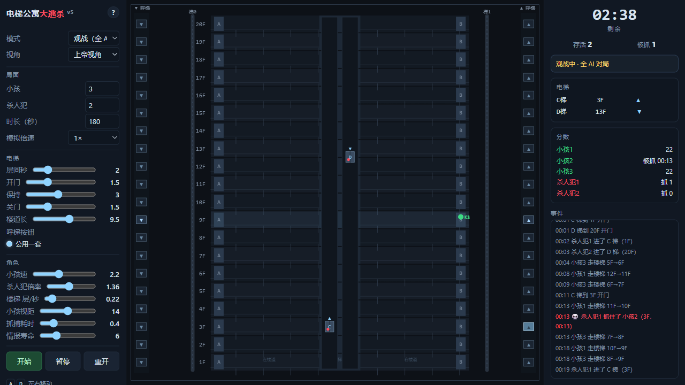
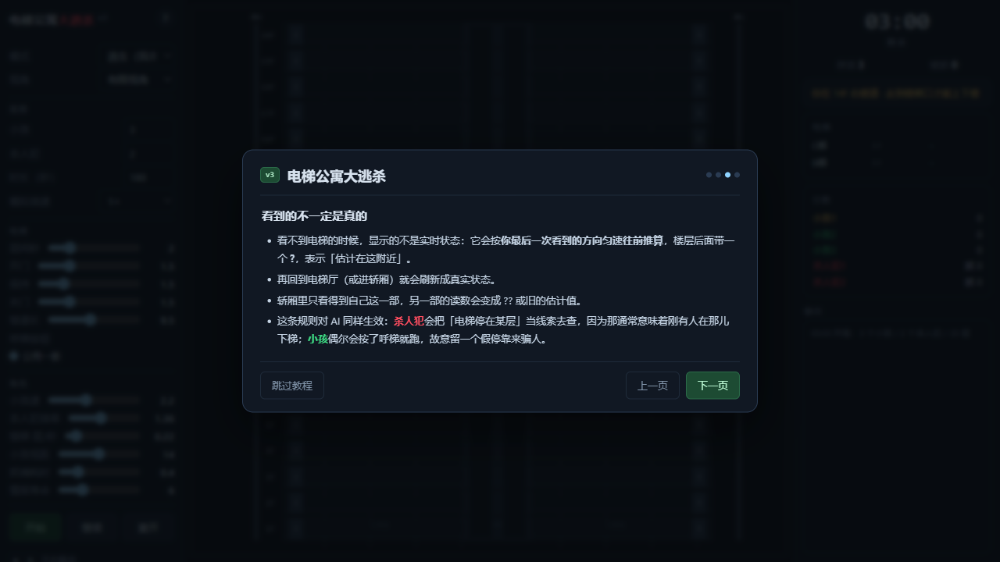
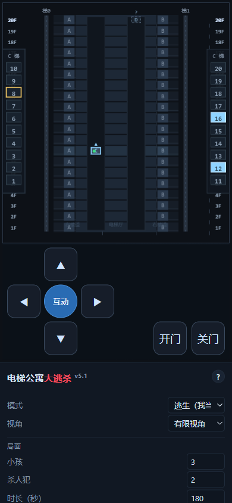
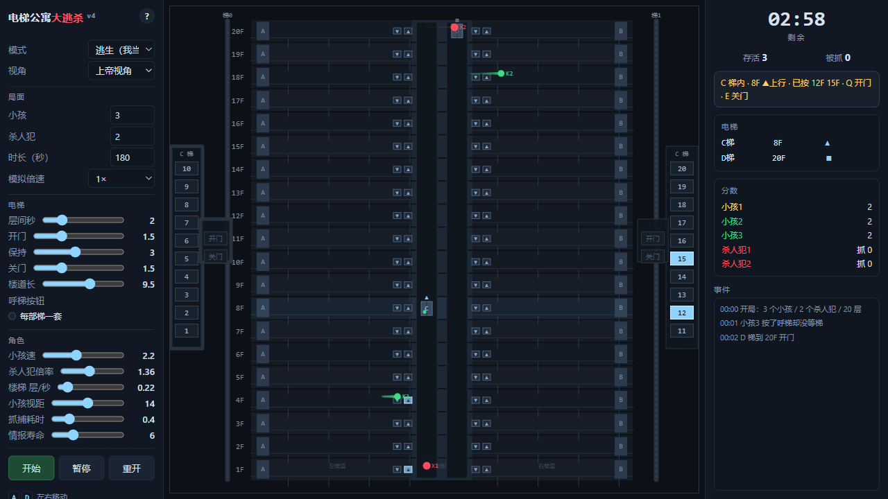
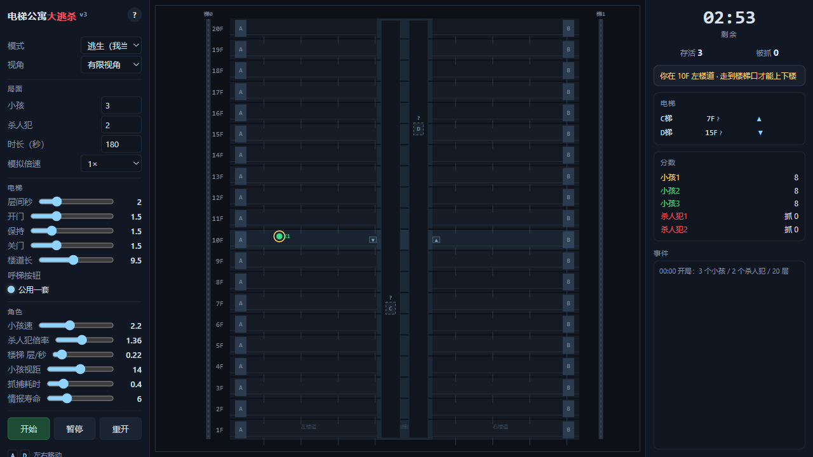

# 电梯公寓大逃杀 v3

二维网页模拟游戏：20 层公寓、2 部电梯、2 部楼梯，3 个小孩靠拖时间得分，2 个杀人犯靠共享频道围猎。
纯原生 JS，**双击 `index.html` 就能玩**，不需要安装、不需要构建、不需要服务器。

在线地址：**https://cyzhou2.github.io/elevator-kill/**（GitHub Pages，push 到 main 自动发布）



进入游戏会先弹一页可跳过的简介 / 教程（左上角 `?` 随时重看）：



## 快速开始

1. 双击 `index.html`（或把它拖进浏览器）。
2. 左侧选模式：`逃生（我当小孩）` / `猎杀（我当杀人犯）` / `观战（全 AI）`。
3. 选视角：`有限视角`（只能看见自己视野内）或 `上帝视角`（全楼可见）。
4. 点「开始」。人数、时长、电梯速度、开关门时间、角色速度、视距、抓捕耗时、情报寿命都能用滑块实时调，调完点「重开」生效。

## 操作

| 按键 | 作用 |
| --- | --- |
| `A` `D` / `←` `→` | 左右移动 |
| `W` `S` / `↑` `↓` | 楼梯口上楼 / 下楼；**楼梯上按反方向键会掉头**，走回出发的楼梯口 |
| `Q` `E` | 电梯厅里按 ▼ / ▲ 呼梯；进轿厢后是**开门 / 关门** |
| `空格` | 电梯厅左半边按 ▼、右半边按 ▲；门开着时**进 / 出电梯** |
| `P` | 暂停 / 继续（暂停会打开菜单：教程 + 设置） |
| 鼠标 | 点每层电梯厅两侧的 ▼▲ 呼梯（C 左、D 右），必须站在本层电梯厅；轿厢里点两端的楼层标识框选层（再点取消）；左上角是开门 / 关门 |

## v7 变更（当前版本）

- **主界面瘦身**：左侧参数栏整个移除，主界面只剩「画布 + 开始/暂停 + 剩余时间」；右侧信息栏保留（竖屏自动隐藏）。
- **暂停即菜单**（像植物大战僵尸那样）：「暂停」打开菜单，第一页是**教程**，第二页是**设置**（所有可调数值都在这里）。
  - **应用**：按菜单里的参数立刻重开一局；
  - **取消**：丢弃改动，回到暂停中的这一局；
  - **继续**：再按一次「继续 / P」直接接着打。
- **去掉「重开」按钮**：要重开就点「开始」，或在菜单里改完参数点「应用」。
- **移动端简化**：竖屏只保留画布、触控按键和剩余时间；固定用「我当小孩 + 黑暗视角」，菜单里也不给切。
- **修长按卡顿**：长按按键超过 1 秒时系统会重复发 keydown，之前会重复触发动作，现在重复事件直接忽略（方向键仍然按住持续走）；顺带把每帧重建的 HUD 做了缓存，只在内容变化时才写 DOM。

## v5.3 变更

- **电梯运行逻辑重写**（见 DESIGN 5.2）：两个方向各有一个每帧重算的事件队列；上行经过的楼层只要有 ▲ 就停（不再看「派给了谁」），下行同理；正方向跑完才换向，反方向有任务立即掉头；两边都空就原地待机（停在非整层时先挪到最近整层）；只要还有没处理的呼梯就立刻去最近的，绝不摸鱼。
- **呼梯按钮回到 v4 位置**：每层电梯厅左边 C 的 ▼▲、右边 D 的 ▼▲。
- **楼层标识就是轿厢按键**：1–20F 两端各一个带框标签（左 C、右 D），按下高亮、到层或取消弹起；上帝视角 / 轿厢内 / 杀人犯共享视野才显示；轿厢内只能按本梯的，**旁观+上帝视角可以按任何呼梯和任何轿厢按键**。
- **开门 / 关门两个键保留**，改用现代电梯符号（尖角朝内=关门、朝外=开门、中间细竖线），位置移到 9F–10F 高度。开门键：门开着刷新倒计时、关门途中按一下重新开门、闲置也能开门；关门键：门开着立即关门。

## v5.2 变更

- **呼梯按钮回到每一层自己的行上**：每层横条的左端是 C 的 ▼▲、右端是 D 的 ▼▲，楼层标记也在同一行的两端，横向一眼就能对上（不再放在画布最外侧的两列）。
- **1–20F 楼层标记**：左右两端都标，加粗，5 的倍数（5F/10F/15F/20F）颜色更亮，不用再数格子。
- **移动端竖屏版**：画布在上、底部一条触控栏（方向键 + 中央「互动」+ 开门/关门），参数与 HUD 排到下面；轿厢选层面板在窄屏会自动缩小并隐藏开关门列（交给触控栏）。
- 车窗面板里的开门/关门仍然保留（桌面端）。

手机竖屏：



## v5.1 变更

- **杀人犯视角共享**：玩杀人犯时，看到的是所有存活杀人犯视野的并集；电梯读数只要有一名队友在电梯厅读到就算数。
- **四项速度可调**：小孩移动 / 小孩爬楼 / 杀人犯移动 / 杀人犯爬楼，删掉原来的「楼梯全局速度 + 杀人犯惩罚」。
- 小孩与杀人犯**视距相同**（一个滑块），AI 小孩加了 **0.2 s 反应时间**（可调）。
- 修好了「改 config.js 不生效」：滑块现在由 `EK.DEFAULTS` 初始化。
- 默认楼道长 = **1 m**。

## v5 变更

- **呼梯按钮搬到画布两侧**：最左一列是 C 的 ▼▲，最右一列是 D 的 ▼▲，每层和楼层横条严格对齐，看楼层就知道点哪个按钮（公用模式下左列只有 ▼、右列只有 ▲）。
- 空格在电梯厅里按「左半边按 ▼、右半边按 ▲」来响应，和墙上的布局一致；门开着时仍然是上下梯。
- 进轿厢后这两列换成选层面板（1–10 层在左、11–20 层在右），不会和呼梯按钮打架。

> 电梯按顺路原则停靠，不会为你掉头：按了 15 层而它正在往下，就先往下走完再上来。
> 停靠时只解除「本方向」的呼梯，反方向的按钮还亮着；等这个方向跑完、而本层还有反方向呼梯时，电梯会**原地再开一次门**把它带走。

## v4 变更

- **键位重排**：`P` 暂停；`空格` = 按身边的按钮 / 进出电梯；`Q`/`E` 在电梯厅是 ▼/▲ 呼梯、在轿厢里是开门/关门；电梯厅不再用 `W`/`S` 呼梯（`W`/`S` 只管楼梯）。
- 电梯门**自动保持 3 秒**（原来是 1.5 秒），轿厢面板多了一列开门/关门按钮。
- 呼梯按钮分成左右两组：**C 的两个按钮全在电梯厅左边，D 的两个全在右边**，按楼层高度对齐。
- 「楼道长」最低可以拖到 **0**（此时楼梯口就在电梯厅两端）。
- 电梯停靠只清本方向呼梯；方向跑完而本层还有反方向呼梯时，原地再开一次门清掉它。
- **同一段楼梯是同一个空间**：上下两个方向迎面撞上也会被抓（楼梯上抓捕距离 1.2 m）。
- 楼梯口附近视野更合理：站在楼梯口能看到刚进楼梯间的人（走到 12% 就看不见了），所以杀人犯能看见你往哪条楼梯跑并跟上去。
- 杀人犯在楼梯上略慢（0.9×），楼梯才是真正的逃生路线。
- 角色加了**渐变拖尾**；爬楼梯时是一条斜向的长拖尾，能看清"从 A 口斜着走到 B 口"。拖尾参数在 `src/config.js` 的 `trail` 里调（界面不暴露）。

轿厢面板（左右两侧选层 + 单独一列开门/关门）：



## v3 变更

- 楼层内部正式命名：**楼梯口 A — 左楼道 — 电梯厅 — 右楼道 — 楼梯口 B**，左右楼道等长、侧栏「楼道长」可调（4–16 m），界面有区域名提示。
- **看得见的和看不见的分开**：看不到电梯时，显示的是「最后一次看到的位置 + 当时方向」按恒定速度推算的虚影，楼层后面带 `?`；回到电梯厅或进轿厢就刷新成真实状态。轿厢里只看得到自己这一部，另一部是 `??` 或旧估计。
- 呼梯按钮**分组对齐楼层**：C 的全部按钮在电梯厅左边、D 的全部在右边，按楼层高度对齐（公用模式则是左 ▼ 右 ▲）。
- 「公用一套 / 每部梯一套」改成侧栏一个**可点亮 / 熄灭的小圆点**：亮 = 公用（群控派梯），灭 = 各自独立。
- AI 开始用电梯信息博弈：
  - 杀人犯会把「某部梯停在别的楼层」当成线索去查（`ai.clueUse`）。
  - 小孩偶尔**按了呼梯就跑**，故意留一个假停靠骗人（`ai.kidBait`）。

看不到电梯时，显示的是外推出来的虚影（带 `?`），回到电梯厅就刷新：



## v2 变更

- 进入游戏时弹出**可跳过**的简介 + 教程（`Esc` / 「跳过教程」直接开始；左上角 `?` 随时重看）。
- **楼梯可以上下楼**：站在楼梯口按 `W` / `S`，落点是斜对角的另一个楼梯口（`A(n) → B(n+1)`）。
- 呼梯按钮支持两种布局（公用一套 / 每部梯一套），墙上按钮可以直接**用鼠标点**。
- 轿厢内不再用 `Enter` 选层：进梯后画面左右两侧出现楼层按钮，点击即按、再点取消，可多选，也能看到别人按亮的楼层。

## 规则要点

- 一局默认 180 秒，没有出口，小孩分数 = 存活时长；杀人犯分数 = 抓到人数 × 100。
- 每层从左到右：`楼梯口A — 左楼道 — 电梯厅（C 梯、D 梯）— 右楼道 — 楼梯口B`，左右楼道等长可调。
- `A(n) ↔ B(n±1)` 属于楼梯 0，`B(n) ↔ A(n±1)` 属于楼梯 1；楼梯段内不可视，两条楼梯互不可见。
- 同层 A 与 B 互不可见，但都能看见电梯厅；站在电梯厅能读到两部梯的楼层和方向；轿厢里只读得到自己这部。
- 看不到电梯时显示的是按最后观察外推的估值（带 `?`），不是实时状态。
- 电梯：恒定 2.0 秒/层，开门 1.5 s、保持 1.5 s、关门 1.5 s；保持方向顺路停靠，不中途掉头；没任务原地待机。
- 每层两部梯的呼梯按钮有两种模式：公用一套（群控派梯）或每部梯独立一套（只叫那一部）。
- 轿厢内可以抓人；站在门口或等梯会挡住关门（同一次停靠最多挡 3 次）。
- 杀人犯共享频道，但只共享各自亲眼看到的：看到小孩就把楼层/位置发进频道，6 秒后过期。

完整规则见 [`docs/DESIGN.md`](docs/DESIGN.md)。

## 目录

```
index.html            页面骨架 + 参数面板
styles.css            样式
src/config.js         所有可调参数与默认值
src/model/building.js 楼层拓扑、楼梯连接、可见性辅助
src/model/elevator.js 单轿厢 SCAN 状态机 + 两部梯群控
src/sim/world.js      实体、移动、上下梯、抓捕、计分、事件
src/sim/perception.js 视野与电梯显示屏读取
src/sim/nav.js        楼梯 vs 电梯的路线估算
src/sim/ai.js         小孩 AI、杀人犯 AI
src/render/renderer.js Canvas 剖面渲染（含有限视角）
src/ui/ui.js          参数读取、HUD、事件日志
src/main.js           游戏循环与键盘输入
tools/headless.js     Node 无头跑一局，检查不变量
tools/mc.js           多局蒙特卡洛（抓捕率/乘车次数/卡死）
tools/sweep.js        参数扫描
tools/diag.js         电梯诊断（开关门次数、乘车人次、方向抖动）
tools/serve.js        本地静态服务器（仅调试用）
docs/DESIGN.md        需求与规则文档
```

## 自测

```bash
node tools/headless.js 180     # 跑一局 180 秒，检查位置/楼层等不变量
node tools/mc.js 12 180        # 跑 12 局，输出平均抓捕数、乘车人次
```

## 已知范围

- 当前地图是一维走廊版（每层一条横向走廊），二维平面地图与 A* 寻路是二期计划，接口已按可替换模块预留（`cfg.map`）。
- AI 是启发式：会逃跑、会等梯、会换层、会报点、会扫楼，但不做长期欺骗性博弈。

## 调参入口

所有数值集中在 `src/config.js` 的 `DEFAULTS`。启动时界面滑块会用 `DEFAULTS` 初始化，所以**改 config 就会生效**（v5.1 修复：以前滑块写死在 HTML 里，会把 config 覆盖掉）。界面上再拖滑块，只影响本次运行。

角色现在有四项速度可调：小孩移动、小孩爬楼、杀人犯移动、杀人犯爬楼；视野共用同一个「视距」；小孩 AI 还有「反应时间」（默认 0.25 s，看到杀人犯后要愣这么久才开跑）。

## 部署到 GitHub Pages

仓库里已经带好 `.github/workflows/pages.yml`，是纯静态站点，不需要构建。步骤：

```bash
# 1. 在 GitHub 上建一个空仓库，然后：
git remote add origin https://github.com/<你的用户名>/<仓库名>.git
git push -u origin main

# 2. 仓库 Settings → Pages → Build and deployment → Source 选 "GitHub Actions"
#    之后每次 push 到 main 都会自动发布
```

发布后地址是 `https://<用户名>.github.io/<仓库名>/`。

也可以直接用命令行建仓库并推送（需要 GitHub CLI 已登录）：

```bash
gh repo create <仓库名> --public --source=. --remote=origin --push
gh api -X POST repos/<用户名>/<仓库名>/pages -f build_type=workflow
```
